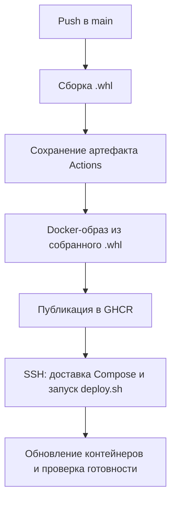

# JSON Workbench

Учебное приложение для проверки и форматирования JSON. Проект демонстрирует полный процесс доставки: исходники → Python-пакет `.whl` → Docker-образ → развёртывание на VPS, а также сбор и отображение метрик.

## Ссылки для проверки

| Что проверить | Ссылка |
|---|---|
| Работающее приложение | [Открыть JSON Workbench](http://46.173.214.243/) |
| Проверка работоспособности | [/health](http://46.173.214.243/health) |
| Метрики приложения | [/metrics](http://46.173.214.243/metrics) |
| Панели мониторинга | [Grafana](http://46.173.214.243:3000/dashboards) |
| Исходный код | [yui-18/json-workbench](https://github.com/yui-18/json-workbench) |
| Сборка и деплой | [GitHub Actions](https://github.com/yui-18/json-workbench/actions/workflows/build.yml) |
| Образ приложения | [Пакет в GHCR](https://github.com/yui-18/json-workbench/pkgs/container/json-workbench) |

**Grafana:** логин `viewer`, роль **Viewer**. Пароль передаётся отдельно. После входа открыть панель **«JSON Workbench — мониторинг»**. Пользователь может просматривать показатели и менять временной диапазон, но не сохранять изменения панели.

Ссылки действуют, пока работает учебный VPS.

## Порядок проверки

1. Открыть приложение и вставить слева:

   ```json
   {"name":"Тест","items":[1,2,3],"enabled":true}
   ```

2. После паузы во вводе справа появится JSON с отступами в четыре пробела.
3. Изменить значение справа — компактный JSON слева обновится автоматически.
4. Удалить скобку — появится сообщение об ошибке на русском. Нажатие на сообщение переводит к позиции ошибки.
5. Проверить кнопки копирования. Если браузер не разрешает Clipboard API, приложение выделяет текст и предлагает скопировать его вручную.
6. Открыть `/health`: ожидается `{"status":"ok"}`.
7. Открыть Grafana: после использования редактора изменяются счётчики и графики. Prometheus опрашивает метрики каждые 15 секунд.

Автоматическое обновление проверялось изменением заголовка страницы: после коммита и `git push` Actions собрал новую версию и обновил сайт без ручного запуска команд на VPS.

## Соответствие требованиям задания

| Требование | Реализация |
|---|---|
| Приложение с проверяемым интерфейсом | Редактирование JSON, форматирование, сообщения об ошибках, копирование |
| Исходники в Git | Код приложения и конфигурация инфраструктуры в репозитории |
| Скрипт сборки | [`scripts/build.sh`](scripts/build.sh) |
| Сохранение сборки как артефакта | `.whl` сохраняется в Actions на 90 дней |
| Упаковка артефакта в контейнер | [`Dockerfile`](Dockerfile) устанавливает собранный `.whl` |
| Скрипт деплоя | [`scripts/deploy.sh`](scripts/deploy.sh), выполняемый по SSH |
| Развёртывание на сервере | Docker Compose и Gunicorn на VPS |
| Возможность изменять приложение | Push в `main` автоматически доставляет новую версию |
| Потребляемые и доступные ресурсы | CPU, RAM, доступная RAM, swap, занятый и доступный диск в Grafana |
| Health check | `/health`, проверки контейнеров и ожидание готовности при деплое |
| Использование за час | Форматирования и успешные загрузки главной страницы за последний час |
| Повторяемый запуск | Команды запуска, сборки и развёртывания ниже |

README описывает первое задание: приложение в контейнере, CI/CD и мониторинг.

## Файлы проекта

| Файл | Назначение |
|---|---|
| [`json_workbench/__init__.py`](json_workbench/__init__.py) | Flask-приложение, API, health check и метрики |
| [`json_workbench/templates/index.html`](json_workbench/templates/index.html) | HTML, CSS и JavaScript без внешних библиотек |
| [`pyproject.toml`](pyproject.toml) | Пакет, зависимости и включение HTML в сборку |
| [`scripts/build.sh`](scripts/build.sh) | Создание `.whl` в `dist/` |
| [`Dockerfile`](Dockerfile) | Установка wheel в образ с Python, запуск Gunicorn |
| [`.dockerignore`](.dockerignore) | В контекст сборки приложения передаются только wheel-файлы из `dist/` |
| [`compose.yaml`](compose.yaml) | Локальная сборка и запуск приложения |
| [`deploy/compose.yaml`](deploy/compose.yaml) | Серверный запуск приложения и мониторинга |
| [`scripts/deploy.sh`](scripts/deploy.sh) | Скачивание образов, обновление контейнеров и проверка готовности |
| [`.github/workflows/build.yml`](.github/workflows/build.yml) | Сборка, сохранение артефакта, публикация и SSH-деплой |
| [`deploy/grafana-dashboard.json`](deploy/grafana-dashboard.json) | Экспорт панели для повторного импорта |

## Запуск из исходников

Нужны Git и Python с `venv` и `pip`. В пакете указан Python ≥ 3.11; CI и Docker используют Python 3.14. Команды ниже рассчитаны на Linux.

```bash
git clone https://github.com/yui-18/json-workbench.git
cd json-workbench
python3 -m venv .venv
.venv/bin/python -m pip install -e .
.venv/bin/python -m flask --app json_workbench run
```

Открыть http://127.0.0.1:5000. Остановка — `Ctrl+C`. Сервер Flask используется для разработки; в Docker приложение обслуживает Gunicorn.

Проверка из другого терминала:

```bash
curl -fsS http://127.0.0.1:5000/health
curl -fsS http://127.0.0.1:5000/metrics
curl -fsS http://127.0.0.1:5000/api/format \
  -H 'Content-Type: application/json' \
  --data '{"text":"{\"name\":\"Тест\"}","mode":"pretty"}'
```

API принимает `mode: pretty` или `compact`. Некорректный JSON возвращает HTTP 400 с описанием ошибки. Лимит тела запроса — 1 МиБ, превышение возвращает HTTP 413.

## Сборка и сохранённый артефакт

Из корня репозитория:

```bash
.venv/bin/python -m pip install build
PATH="$PWD/.venv/bin:$PATH" bash scripts/build.sh
.venv/bin/python -m zipfile -l dist/json_workbench-0.1.0-py3-none-any.whl
```

Результат — `dist/json_workbench-0.1.0-py3-none-any.whl`. Внутри находятся Python-код, HTML-шаблон и метаданные. Flask, Gunicorn и Prometheus Client перечислены как зависимости и устанавливаются `pip`, а не вложены в wheel.

Для проверки установки отдельно от исходников:

```bash
python3 -m venv build/wheel-check
build/wheel-check/bin/python -m pip install dist/json_workbench-0.1.0-py3-none-any.whl
build/wheel-check/bin/python -I -c 'import json_workbench; print(json_workbench.__file__)'
build/wheel-check/bin/python -I -c 'from json_workbench import app; app.run(host="127.0.0.1", port=5002)'
```

Открыть http://127.0.0.1:5002. Ключ `-I` исключает текущую папку из поиска модулей, поэтому проверяется установленный пакет. `build/`, `dist/` и `.venv` исключены из Git.

**Скачать сборку:** GitHub → **Actions → Build and publish → конкретный запуск → Summary → Artifacts → `wheel-…`**. Скачивается архив с `.whl`. Для скачивания нужен вход в GitHub и доступ на чтение публичного репозитория.

Артефакт называется `wheel-<commit SHA>` и хранится **90 дней** для запусков с текущей настройкой `retention-days: 90`. Более ранние артефакты могут иметь прежний срок хранения. Docker-образ хранится отдельно в GHCR.

## Локальный запуск в контейнере

Нужны запущенный Docker Engine и Docker Compose. Сначала собрать wheel, затем из корня репозитория:

```bash
docker compose up -d --build
docker compose ps
curl -fsS http://127.0.0.1:5001/health
```

Приложение: http://127.0.0.1:5001. Локальный Compose запускает только редактор; весь стек мониторинга описан в `deploy/compose.yaml`.

```bash
docker compose logs -f web
docker compose down
```

Если у пользователя нет доступа к Docker, использовать `sudo` перед Docker-командами. После изменения Python-кода или HTML сначала пересобрать `.whl`, затем выполнить `docker compose up -d --build`: Dockerfile устанавливает пакет из `dist/` и сам не собирает исходники.

## Процесс CI/CD

Workflow запускается после push в `main` или вручную через **Actions → Build and publish → Run workflow**.



1. `checkout` получает исходники, `setup-python` подготавливает Python 3.14.
2. `scripts/build.sh` создаёт wheel, **Save wheel** сохраняет его как артефакт Actions.
3. Dockerfile устанавливает тот же wheel из рабочей папки запуска. Сохранённая копия остаётся доступной для скачивания; повторно скачивать артефакт внутри этого единственного job не требуется.
4. Образ публикуется как `ghcr.io/yui-18/json-workbench:<commit SHA>` и `ghcr.io/yui-18/json-workbench:latest`.
5. В серверный Compose подставляется **тег текущего коммита**, поэтому деплой использует конкретную сборку.
6. Готовый Compose-файл копируется в `/opt/json-workbench/compose.yaml`. Содержимое `scripts/deploy.sh` передаётся по SSH и выполняется на сервере.
7. Скрипт проверяет конфигурацию, скачивает образы, пересоздаёт Prometheus для применения встроенного config и обновляет остальные сервисы.
8. `--wait --wait-timeout 120` ожидает готовности. Для сервисов с healthcheck проверяется `healthy`; для Node Exporter без healthcheck — запуск процесса. Сбор его метрик отдельно проверяется через `up{job="node"}`.
9. Временные файлы SSH-ключа удаляются шагом с `if: always()`.

Очередь запусков для одной ветки ограничена через `concurrency`. При обновлении единственного экземпляра приложения возможен короткий перерыв. Prometheus ненадолго прерывает сбор при пересоздании; история в томе сохраняется. Автоматического отката нет.

### Авторизация Actions

Для публикации применяется временный `GITHUB_TOKEN` с разрешениями `contents: read` и `packages: write`. Для деплоя в **Settings → Secrets and variables → Actions → Repository secrets** заданы:

| Секрет | Значение |
|---|---|
| `VPS_HOST` | IP сервера, без протокола и порта |
| `VPS_USER` | Пользователь деплоя — `deploy` |
| `VPS_SSH_KEY` | Закрытый ключ, разрешённый для входа этим пользователем |
| `VPS_KNOWN_HOSTS` | Строка `IP ssh-ed25519 PUBLIC_HOST_KEY` для проверки сервера на порту 22 |

SSH использует `StrictHostKeyChecking yes`. Открытый ключ клиента находится на VPS в `/home/deploy/.ssh/authorized_keys`. Закрытый ключ и пароли не хранятся в исходниках.

## Повторное развёртывание на сервере

Текущий VPS: Ubuntu 26.04.1 LTS, около 1 ГиБ RAM, диск 20 ГБ. Дополнительно подключён swap-файл 1 ГиБ с записью в `/etc/fstab`.

Для повторения нужны Linux, Bash, Git, Docker Engine и Compose. Нужны исходящие подключения к GHCR и Docker Hub, свободные порты 80 и 3000. Автоматический деплой использует SSH на порту 22.

### Ручной запуск готового образа

На новом Ubuntu-сервере под `root`:

```bash
apt update
apt install docker.io docker-compose-v2 git
systemctl enable --now docker

git clone https://github.com/yui-18/json-workbench.git
cd json-workbench
mkdir -p /opt/json-workbench
APP_IMAGE=ghcr.io/yui-18/json-workbench:latest \
  docker compose -f deploy/compose.yaml config \
  > /opt/json-workbench/compose.yaml
bash scripts/deploy.sh /opt/json-workbench
```

Приложение на сервере не собирается: используется опубликованный образ. Для конкретной версии заменить `latest` на опубликованный commit SHA. На новом сервере перед публичным запуском Grafana следует выполнить начальную настройку с локальным портом, как описано ниже.

Серверный `/opt/json-workbench/compose.yaml` уже содержит конкретный адрес образа, поэтому при дальнейших командах в этой папке `APP_IMAGE` не требуется.

### Подготовка SSH-деплоя

Создать отдельную пару SSH-ключей для Actions. На новом сервере под `root`:

```bash
adduser --disabled-password --gecos "" deploy
usermod -aG docker deploy
mkdir -p /opt/json-workbench
chown -R deploy:deploy /opt/json-workbench
install -d -m 700 -o deploy -g deploy /home/deploy/.ssh
```

Записать открытый ключ клиента в `/home/deploy/.ssh/authorized_keys`, установить владельца `deploy:deploy` и права `600`. Проверить SSH-вход под `deploy` и команду `docker ps`. Группа `docker` даёт широкие полномочия, фактически уровня root через Docker.

Добавить четыре Repository secrets из таблицы выше. Пакет GHCR должен быть Public для скачивания без registry-токена. При переносе в другой репозиторий Actions получает адрес образа из `GITHUB_REPOSITORY`.

## Мониторинг

| Компонент | Назначение | Доступ |
|---|---|---|
| Flask `/metrics` | Счётчики запросов и показатели Python-процесса | Через приложение |
| Node Exporter | CPU, RAM, swap и файловые системы VPS | `node-exporter:9100` внутри сети Compose |
| Prometheus | Опрос метрик и хранение истории | Внутренняя сеть и только `127.0.0.1:9090` на хосте |
| Grafana | Панель с числами и графиками | Порт 3000, вход по логину и паролю |

Node Exporter получает корень VPS как `/host` для чтения и использует `pid: host`. Включены сборщики CPU, meminfo, filesystem, loadavg и uname. Его показатели относятся ко всей VPS; показатели отдельного Python-процесса доступны через `/metrics` приложения.

Prometheus хранит историю до семи дней с дополнительным лимитом блоков данных 512 МБ. Это не жёсткий предел всей директории: журнал и служебные данные также занимают место. История находится в томе `prometheus_data`, пользователи и панели Grafana — в `grafana_data`. Обновление контейнеров эти тома не удаляет.

### Восстановление Grafana на новом сервере

Источник Prometheus создаётся автоматически из `configs.grafana_datasources`. Панель и пользователь Viewer создаются отдельно:

1. До начальной настройки заменить публикацию Grafana на `127.0.0.1:3000:3000` и подключиться через SSH-туннель. В свежей Grafana войти как `admin` / `admin` и сразу сменить пароль.
2. **Dashboards → New → Import**: загрузить `deploy/grafana-dashboard.json` и нажать **Import**.
3. Создать пользователя `viewer`, роль **Viewer** в организации, **Grafana Admin: No**.
4. Передать пароль, после настройки при необходимости вернуть публичный порт и применить Compose.

Самостоятельная регистрация и анонимный доступ отключены. Панель хранится в Git, но автоматически не импортируется при деплое. На существующем сервере панель и пользователи сохраняются в томе. Часовой пояс панели — `Asia/Yekaterinburg` (UTC+5).

### Метрики приложения

| Метрика | Что считается |
|---|---|
| `json_workbench_format_requests_total{status="…"}` | Завершённые POST-запросы `/api/format`, отдельно по HTTP-статусу |
| `json_workbench_page_views_total` | Успешные GET-загрузки главной страницы `/` |

Обновление страницы увеличивает загрузки, редактирование JSON — запросы форматирования. Это запросы, а не уникальные посетители: боты и повторные обращения тоже учитываются. Чтение `/metrics` и проверки `/health` не увеличивают эти счётчики.

Счётчики находятся в памяти и сбрасываются при перезапуске рабочего процесса. Gunicorn работает с одним worker; увеличение числа процессов потребует multiprocess-настройки метрик. Prometheus хранит историю и учитывает наблюдаемые сбросы при расчёте прироста.

Примеры запросов:

```promql
# Успешное получение метрик
up{job="json-workbench"}
up{job="node"}

# Форматирования за последний час
sum(increase(json_workbench_format_requests_total{job="json-workbench"}[1h])) or vector(0)

# Загрузки страницы за последний час
sum(increase(json_workbench_page_views_total{job="json-workbench"}[1h])) or vector(0)

# Средняя частота форматирования: запросов/мин, окно 1 минута
sum by (status) (rate(json_workbench_format_requests_total{job="json-workbench"}[1m])) * 60
```

`up = 1` означает успешное чтение метрик, а не полную проверку функций редактора. `/health` проверяется отдельно Docker healthcheck. `increase` и `rate` рассчитываются по измерениям; число за час является оценкой и может быть дробным. Ноль в панелях с `or vector(0)` также возможен при отсутствии данных — доступность нужно оценивать отдельно по `up`.

Панель показывает CPU, использование и доступность RAM, занятый swap, использование и доступность корневого диска, получение метрик, форматирования и загрузки страницы за час, частоту запросов во времени.

## Обслуживание и диагностика на VPS

```bash
cd /opt/json-workbench
docker compose ps -a
docker compose logs --tail=100 web
docker compose logs --tail=100 prometheus
docker compose logs --tail=100 grafana
docker stats --no-stream
curl -fsS http://127.0.0.1/health
free -h
df -h /
swapon --show
```

Внутренний Prometheus можно открыть через SSH с основной машины:

```bash
ssh -i ~/.ssh/json-workbench-deploy \
  -o ExitOnForwardFailure=yes \
  -N -L 127.0.0.1:9090:127.0.0.1:9090 \
  deploy@46.173.214.243
```

Открыть http://127.0.0.1:9090 и выполнить `up`. Нужен собственный разрешённый ключ; закрытый ключ Actions не передаётся. Для просмотра мониторинга доступна внешняя Grafana.

Статус `unhealthy` сам по себе не вызывает перезапуск. `restart: unless-stopped` действует при завершении процесса и после запуска Docker, если контейнер не остановлен вручную.

`docker compose down` сохраняет именованные тома. **`docker compose down -v` удаляет историю Prometheus и данные Grafana**, поэтому для обычного обновления не используется. Деплой выполняет `pull` и `up`, без удаления томов.

## Ограничения учебного развёртывания

- HTTP без TLS — временная демонстрационная конфигурация.
- Prometheus и Node Exporter не опубликованы напрямую в интернет; интерфейс просмотра — Grafana.
- Зависимости Python частично заданы диапазонами. Lock-файл и фиксация базовых образов по digest не реализованы; новая сборка может получить новые подходящие версии зависимостей.
- Деплой одного экземпляра допускает короткий перерыв; автоматического отката и резервного сервера нет.
- Сохранение томов защищает от потери данных при пересоздании контейнера, но внешние резервные копии не настроены.

## Материалы для сдачи

- Репозиторий с исходниками и описанием процесса.
- Скрипты [`build.sh`](scripts/build.sh), [`deploy.sh`](scripts/deploy.sh), [`Dockerfile`](Dockerfile), Compose и workflow Actions.
- Ссылка на успешный запуск Actions с сохранённым wheel-артефактом.
- Ссылки на приложение, `/health`, `/metrics` и Grafana.
- Логин `viewer` и отдельно переданный пароль.
- Экспорт [`grafana-dashboard.json`](deploy/grafana-dashboard.json).

Для проверки доставленной версии можно сопоставить SHA коммита в Actions с тегом образа работающего контейнера через `docker compose ps` на сервере.
